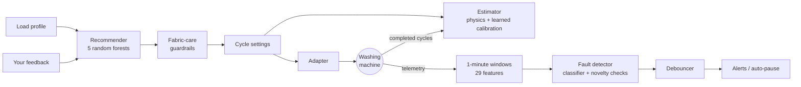

# SmartWash: an AI brain for your smart washing machine

SmartWash is an AI model plus the plumbing to connect it to a real washing machine. You describe
what is going in the drum, and it:

- **recommends the cycle**: programme, temperature, spin speed, pre-wash, extra rinse and
  detergent dose, with a time/energy/water estimate and a plain-English reason for each choice;
- **never risks your clothes**: hard fabric-care guardrails sit between the model and the machine,
  so nothing is ever washed hotter, spun faster or treated harsher than the fabric allows;
- **starts and watches the machine**: it reads live sensor telemetry, diagnoses six fault types
  (blocked drain, failing heater, worn bearings, unbalanced load, slow water supply, motor
  overload) and flags anything else unusual, pausing the cycle on critical faults;
- **learns your household and your machine**: your choices and ratings personalise the
  recommendations, and every completed cycle calibrates the time and energy estimates;
- **notifies you** (webhook) when a cycle starts, finishes, or something looks wrong.

It talks to Bosch/Siemens (Home Connect), Samsung (SmartThings), LG (ThinQ), anything in
Home Assistant, and DIY/ESP32 machines over MQTT. It also includes a physics-based virtual washer,
so you can try everything without hardware.

```text
$ smartwash recommend --fabric sportswear --soil heavy --weight 3.5 --stain mud --stain protein
Recommended cycle (confidence 90%)
  Programme    sportswear
  Temperature  40 °C
  Spin         800 rpm
  Pre-wash     yes
  Extra rinse  no
  Detergent    about 35 ml
  Estimate     89 min, 0.80 kWh, 45 L of water
Why:
  - Sportswear programme: lifts sweat and odour while protecting technical fibres.
  - 40 °C cleans everyday laundry well without fading colours.
  - An 800 rpm spin balances water extraction against creasing.
  - Pre-wash loosens mud and protein (blood, sweat) stains before the main wash.
  - Use about 35 ml of detergent for 3.5 kg of heavily soiled laundry in medium water.

$ smartwash simulate --fabric towels --color whites --weight 5 --fault drain_blockage --severity 0.8
Simulating towels 60 °C 1200 rpm with 5 kg (injected fault: drain_blockage); estimate 137 min
    0.0 min  fill
    1.4 min  wash
   95.5 min  drain
   97.5 min  !! drain_blockage detected (100% confident, critical)
             Water is draining far too slowly; the pump filter or drain hose is probably blocked.
             Advice: Stop the cycle, clean the drain-pump filter and check the drain hose for kinks before restarting.
             SmartWash pauses the cycle here.
```

## Quick start (no hardware needed)

Requires Python 3.10+.

```bash
python -m venv .venv && source .venv/bin/activate
pip install -e ".[dev]"

smartwash train                                   # trains both AI models (~30 s)
smartwash recommend --fabric wool --color darks --weight 1.5
smartwash simulate --program cotton --temperature 60 --spin 1400 --fault heater_failure
smartwash serve                                   # REST API + live monitoring
```

Then open <http://127.0.0.1:8000/docs> for the interactive API. By default the server drives the
virtual washer at 60x real time, so a two-hour cycle takes two minutes. To watch the AI catch a
fault live, start a cycle and inject one:

```bash
curl -X POST localhost:8000/cycles -H 'Content-Type: application/json' \
     -d '{"profile": {"fabric": "towels", "color": "whites", "weight_kg": 5}}'
curl -X POST localhost:8000/simulator/fault -H 'Content-Type: application/json' \
     -d '{"fault": "motor_overload"}'
curl localhost:8000/diagnostics        # the alert, and the cycle has been paused for safety
```

## Connect your washing machine

| Your machine | Adapter | AI chooses programme, °C, spin | Pause / resume | AI fault detection | Setup |
|---|---|---|---|---|---|
| Bosch, Siemens, Neff, Gaggenau, Thermador | `home_connect` | yes | yes | no¹ | [guide](docs/cloud-adapters.md#home-connect-bosch-siemens-neff-gaggenau-thermador) |
| Samsung | `smartthings` | yes, once cycle ids are mapped | yes | no¹ | [guide](docs/cloud-adapters.md#samsung-smartthings) |
| LG | `lg_thinq` | no: starts the course set on the machine² | no | no¹ | [guide](docs/cloud-adapters.md#lg-thinq-native) |
| Anything in Home Assistant (LG, Miele, Electrolux, Whirlpool, GE, ...) | `home_assistant` | depends on the integration | if configured | no¹ | [guide](docs/cloud-adapters.md#home-assistant-any-brand) |
| DIY / ESP32 / custom, or a retrofitted machine | `mqtt` | yes | yes | **yes** | [protocol](docs/mqtt-protocol.md) |
| No machine yet | `simulator` | yes | yes | yes | built in |

¹ Manufacturers' cloud APIs don't publish the sensor data (drum speed, vibration, motor
current, water level...) that fault detection needs. Everything else works. For fault
detection, add sensors and use the MQTT adapter.
² A limit of LG's official API.

1. Copy the example config and pick your adapter:

   ```bash
   cp config.example.yaml config.yaml     # config.yaml is git-ignored
   # edit machine.adapter and its block; put tokens in environment variables
   export HOME_CONNECT_TOKEN=...
   ```

2. Find your machine and check the connection:

   ```bash
   smartwash devices        # washers on your account (ids, models, Samsung cycle ids)
   smartwash status         # current state
   ```

3. **Enable remote start on the machine.** Every manufacturer requires someone at the washer to
   allow remote start after loading it and closing the door.
4. Run `smartwash serve` and use the API, or use the CLI directly: `smartwash start --fabric
   cotton --color whites --weight 5`, `smartwash pause`, `smartwash stop`.

## The API

| Endpoint | What it does |
|---|---|
| `POST /recommend` | Load profile in, recommendation out (settings, estimate, reasons, alternatives) |
| `POST /cycles` | Start a cycle: `{"profile": ...}` lets the AI choose; add `"settings"` to choose yourself (checked against the load's care limits and remembered as a preference) |
| `GET /cycles` | History of cycles: duration, energy, faults |
| `GET /machine` | Live state, progress, remaining time, capabilities |
| `POST /machine/pause` · `/resume` · `/stop` | Control the running cycle |
| `GET /diagnostics` | Fault detector: latest verdict, this cycle's faults, recent alerts |
| `POST /feedback` | Tell it what you used or prefer for a load, optionally with a 1-5 rating |
| `POST /model/retrain` | Retrain the recommender with your feedback |
| `GET /model` | Model versions, training metrics, learned calibration |
| `POST /simulator/fault` | Simulator only: give the virtual washer a fault |
| `GET /health` | Liveness, the only endpoint that doesn't need the API key |

A load profile looks like this (only `fabric` is required):

```json
{
  "fabric": "cotton",
  "color": "whites",
  "soil": "heavy",
  "weight_kg": 5,
  "stains": ["grease"],
  "sensitive_skin": false,
  "eco_priority": 0.8,
  "max_duration_min": 120,
  "water_hardness": "hard"
}
```

The values are:
- **fabric:** `cotton`, `synthetic`, `wool`, `delicate`, `denim`, `bedding`, `towels`, `sportswear`, `mixed` or `baby`.
- **color:** `whites`, `lights`, `colors` or `darks`.
- **soil:** `light`, `normal` or `heavy`.
- **stains:** any of `protein`, `grease`, `tannin` and `mud`.
- **eco_priority:** from 0 (best, fastest clean) to 1 (least energy).

Errors are mapped to HTTP statuses:
- **409:** the machine refuses in its current state, for example busy, door open or remote start disabled.
- **501:** the connection can't do that.
- **502:** the machine or its cloud failed.

**Security.** The server listens on `127.0.0.1` only. Before exposing it to your network, set
`api.api_key` in the config, and send it as an `X-API-Key` header.

## How the AI works



- **Recommender.** Five random forests predict the programme, temperature, spin, pre-wash and
  extra rinse from the load profile. On day one there is no usage data, so they are trained on
  20,000 synthetic loads. Those loads are labelled by a rule-based laundry expert distilled from
  textile-care guidance (care-label limits, colour fastness, soil and stain handling). The expert
  deliberately varies its choices the way real experts do, so the model's confidence and
  alternatives mean something. Your feedback is added with a high weight, so the model drifts
  towards your household's habits for similar loads and leaves other loads alone.
- **Guardrails.** Every model output, and every piece of feedback before it is learned from, is
  checked against hard limits. These are each fabric's maximum temperature and spin, the colour's
  maximum temperature, and the harshest programme the fabric tolerates. The model can learn
  preferences; it can never learn to shrink your jumper.
- **Estimator.** A first-principles model of fill, heating, tumbling, draining and spinning
  estimates duration, energy and water. Each completed cycle then teaches it how your machine
  differs, through per-programme correction factors shrunk towards a machine-wide factor. One odd
  cycle can't throw it off.
- **Fault detector.** Telemetry is cut into one-minute windows per phase. Each window becomes
  physically meaningful features: speed deficit, vibration relative to speed, heater power and
  heating efficiency, fill and drain rates, and so on. A random forest diagnoses known faults. An
  isolation forest and a per-phase "healthy envelope" flag anything else unusual. A fault is
  reported only when consecutive windows agree, and critical faults pause the cycle.

The detector is trained on a physics simulator with injected faults:
- **Training cycles:** 300 simulated cycles. 30% of them use arbitrary hand-picked settings rather than expert ones.
- **Fault severities:** from early-stage (subtle) to severe.
- **Calibration:** thresholds are tuned on complete healthy cycles so false alarms stay rare.

Current results on held-out cycles:

| Model | Metric | Result |
|---|---|---|
| Recommender | Agrees with the expert on programme / temperature / spin | 96% / 97% / 99% |
| | Raw outputs the guardrails had to correct | 0.5% |
| Fault detector | Faulty cycles caught (blocked drain, heater, bearings, imbalance, water supply) | 100% |
| | Faulty cycles caught (mild motor overload, which resembles a heavy load) | 89% |
| | False alarms on healthy cycles (59 test + 30 full-length) | 0% |
| | Typical detection delay once a fault shows | ~1-2 minutes |

**Read these numbers honestly.** They are measured on synthetic data from the same rules and
simulator the models were trained on. They show the models learned what they were taught. They do
not show how a real machine will behave. Real telemetry is noisier, so expect lower accuracy until
the models have seen data from your machine. The recommender's rules encode general textile-care
guidance: always follow the care labels on your clothes. See [docs/ai-models.md](docs/ai-models.md)
for features, training data, calibration and how to retrain on real data.

## Safety

- The guardrails cap temperature, spin and drum action for every cycle SmartWash starts.
- The adapters round down to what your machine offers. They refuse to start when the machine can't
  go low enough, and they only fall back to equal or gentler programmes.
- SmartWash's only automatic action is pausing a cycle on a critical fault. It never starts a cycle
  on its own.
- Remote start must be enabled on the machine by someone standing at it, as manufacturers
  require.
- DIY sensor retrofits involve mains voltage and water. Read the safety section of
  [docs/mqtt-protocol.md](docs/mqtt-protocol.md) first. Never bypass the door lock or other
  interlocks.

## Configuration

Everything lives in one YAML file, `config.yaml`, or the path in `$SMARTWASH_CONFIG` or
`--config`. [`config.example.yaml`](config.example.yaml) documents every option:
- **machine:** the adapter and its connection settings.
- **models:** where models are stored and whether to auto-train them.
- **monitoring:** polling interval, debouncing and auto-pause.
- **notifications:** the webhook URL.
- **api:** host, port and API key.

Secrets are written as `${ENV_VAR}` and read from the environment.

The webhook receives a JSON POST for each event: `cycle_started`, `cycle_finished`,
`cycle_stopped`, `machine_error`, `fault_detected` and `auto_paused`. Each body has `event`,
`title`, `message`, `data` and `timestamp`. It also has a `text` field, so Slack-style chat
webhooks show it as a message.

## Project layout

```text
src/smartwash/
  schemas.py        domain model (loads, settings, machine state, telemetry, diagnoses)
  knowledge.py      laundry-care expert, guardrails, explanations, fault advice
  physics.py        washing-machine physics shared by the simulator and estimator
  ai/               recommender, estimator, fault detector, datasets, training, registry
  devices/          adapters: simulator, mqtt (+ virtual MQTT washer), home_connect,
                    smartthings, lg_thinq, home_assistant
  controller.py     connects the AI to the machine: start, monitor, auto-pause, learn
  api.py, cli.py    REST API and command line
docs/               cloud adapter setup, MQTT protocol, AI model details
tests/              unit, integration (live Mosquitto broker) and end-to-end tests
```

## Development

```bash
pip install -e ".[dev]"
pytest                  # ~2 min; the MQTT integration tests need mosquitto installed
ruff check . && ruff format --check .
```
